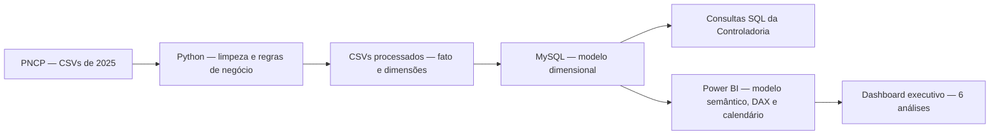
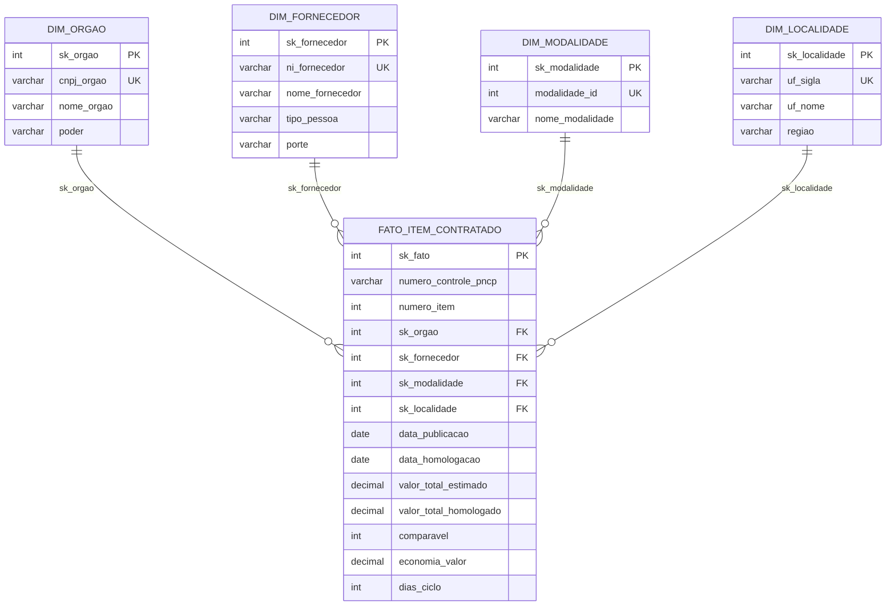

# PNCP | Controladoria — Análise de Contratações Públicas (2025)

**Projeto Avaliativo — Módulo 2 · Análise de Dados com Python e MySQL**  
**Tecnologias:** Python · Pandas · MySQL · SQL · Power BI · DAX  

## 1. Apresentação

Este projeto desenvolve uma esteira de dados **de ponta a ponta (end-to-end)** para analisar contratações públicas registradas no **Portal Nacional de Contratações Públicas (PNCP)**. O objetivo é transformar arquivos com inconsistências cadastrais, monetárias e temporais em um modelo dimensional íntegro, consultável em MySQL e apresentado à Controladoria por meio de um dashboard executivo no Power BI.

A solução responde a seis perguntas: **quanto foi economizado; quem concentra o volume contratado; quais modalidades se destacam; quanto dura o ciclo de compra; onde estão os gastos e a economia; e como os recursos se distribuem por perfil de gasto**.

## 2. Arquitetura da solução



### Organização do repositório

```text
Projeto_Modulo_2/
├── .vscode/
│   └── settings.json
├── data/
│   ├── raw/
│   │   ├── compras.csv
│   │   ├── itens.csv
│   │   └── resultados.csv
│   └── processed/
│       ├── dim_orgao.csv
│       ├── dim_fornecedor.csv
│       ├── dim_modalidade.csv
│       ├── dim_localidade.csv
│       └── fato_item_contratado.csv
├── docs/
│   └── img/
│       └── sprints.png
├── powerbi/                         
│   └── ProjFinMod2.pbix
├── sql/
│   ├── 01_criar_banco.sql
│   └── 02_perguntas.sql
├── src/
│   ├── __init__.py
│   ├── banco.py
│   ├── carregar.py
│   ├── config.py
│   ├── limpeza.py
│   └── montar_tabelas.py
├── .env                             # arquivo local: NÃO versionar
├── .gitignore
├── README.md
└── requirements.txt
```

## 3. Fonte de dados e diagnóstico inicial

A base disponibilizada possui três arquivos, com granularidades diferentes:

| Arquivo | Grão | Registros de origem | Conteúdo principal |
|---|---|---:|---|
| `compras.csv` | Uma contratação/edital | **2.042** | Identificação PNCP, órgão, modalidade, UF, publicação e objeto |
| `itens.csv` | Um item licitado | **7.077** | Descrição, quantidade, valores estimados e sigilo |
| `resultados.csv` | Um resultado/classificação de fornecedor por item | **15.896** | Fornecedor, ordem de classificação, valores homologados, datas e cancelamento |

Em `compras.csv`, os **2.042 identificadores `numero_controle_pncp` são distintos**, sem duplicação dessa chave no cabeçalho. Já a repetição do identificador nos arquivos de itens e resultados é esperada por suas respectivas granularidades.

### Dicionário de inconsistências e decisões de tratamento

| Inconsistência / condição | Regra aplicada | Implementação |
|---|---|---|
| Textos com espaços extras, caracteres invisíveis, valores como `N/A`, `NULL`, `-` e acentos corrompidos | Normalização de espaços e Unicode; reconhecimento de nulos textuais; padronização de nomes em maiúsculas | `src/limpeza.py` |
| CNPJ/CPF com máscara ou zeros à esquerda ausentes | Manutenção apenas dos dígitos para PJ/PF e preenchimento à esquerda (14/11 posições); identificador estrangeiro preservado como texto | `src/limpeza.py` |
| Valores monetários expressos em texto e diferentes separadores | Conversão para número; quando só existe um `.` ou `,`, trata-se de decimal; separadores repetidos indicam milhar; com ambos os símbolos, o último indica o decimal | `src/limpeza.py` |
| Datas em formatos distintos, incluindo data/hora | Conversão de formatos reconhecidos para `DATE`, rejeitando datas impossíveis e anos fora do intervalo previsto | `src/limpeza.py` |
| Múltiplos fornecedores classificados para um mesmo item | Primeiro elimina resultados cancelados; depois seleciona a menor ordem de classificação e desempata pelo menor `sequencial_resultado` | `src/montar_tabelas.py` |
| Itens sem resultado válido | Exclusão da tabela fato, antes da etapa de rejeição | `src/montar_tabelas.py` |
| Quantidades, preços, sigilo ou valores totais incompatíveis com as regras | Cálculo dos totais e rejeição de itens inválidos; os motivos são codificados na expressão `rejeitado` | `src/montar_tabelas.py` |
| Itens cujo valor estimado e homologado não são comparáveis | Indicador `comparavel = 0` para Credenciamento ou razão homologado/estimado fora de `[0,1; 10]`; permanecem no volume, mas não na economia | `src/montar_tabelas.py` |
| Homologação anterior à publicação ou data de homologação inválida | Anula `data_homologacao` e `dias_ciclo` sem excluir o item da fato | `src/montar_tabelas.py` |
| Ausência de uma classe de gasto pronta | Classifica o item como **Bens**, **Serviços** ou **Obras e engenharia** com base em categoria e palavras-chave | `src/montar_tabelas.py` |
| Região geográfica não disponível na origem | Enriquecimento pela correspondência de UF com a região brasileira | `src/montar_tabelas.py` |
| Modalidades apresentadas como códigos | Padronização pelo dicionário de modalidades definido no projeto | `src/montar_tabelas.py` |

**Regras que merecem destaque:**

- A **quantidade homologada**, quando positiva, é utilizada tanto no cálculo do valor total estimado quanto no homologado; caso contrário, utiliza-se a quantidade do item.
- A tabela fato possui **uma linha por `numero_controle_pncp` + `numero_item`**, e não uma linha por fornecedor classificado.
- O indicador financeiro de **economia considera apenas itens comparáveis**. O **volume homologado considera todos os itens válidos**, inclusive os não comparáveis.
- O código atual grava **`economia_valor = 0`** nos itens não comparáveis, em vez de `NULL`, como mencionado literalmente em um trecho do enunciado. Essa decisão segue a implementação do roteiro Python utilizado, não altera a economia agregada e deve ser considerada em eventuais auditorias.
- A classificação **Obras e engenharia** tem precedência sobre as demais. O padrão utiliza palavras inteiras relacionadas a *obra*, *construção*, *reforma* e *engenharia*; fora desse grupo, a classificação é dada por `material_ou_servico`.
- A análise de ciclo por órgão agrupa pelo **nome do órgão padronizado** e considera órgãos com **pelo menos cinco itens com ciclo válido**. A quantidade de unidades compradoras, por sua vez, é calculada por **CNPJ distintos**.

## 4. Modelagem dimensional no MySQL

Adotou-se um **Star Schema**: a tabela fato concentra valores, quantidades, datas, indicadores de economia e chaves substitutas; dimensões concentram os atributos descritivos de órgãos, fornecedores, modalidades e localidades.



A restrição de unicidade da fato utiliza **(`numero_controle_pncp`, `numero_item`)**. As dimensões possuem chaves naturais com `UNIQUE` e relacionamentos 1:N (dimensão → fato). Valores monetários totais são armazenados como `DECIMAL(18,2)`, e preços unitários e quantidades usam `DECIMAL(18,4)`.

| Tabela | Quantidade após o processamento |
|---|---:|
| `fato_item_contratado` | 6.126 |
| `dim_orgao` | 363 |
| `dim_fornecedor` | 2.652 |
| `dim_modalidade` | 7 |
| `dim_localidade` | 27 |

No Power BI são acrescentadas as tabelas **`Calendario`** (dimensão de tempo construída em DAX) e **`Medidas`** (tabela técnica para as medidas explícitas). O Calendário possui vínculos com publicação e homologação, sendo um ativo e outro inativo para utilização contextual com `USERELATIONSHIP`.

## 5. Tecnologias e decisões técnicas

| Tecnologia | Papel na solução | Justificativa |
|---|---|---|
| **Python** | Processamento em etapas executáveis | Reprodutibilidade e separação de responsabilidades |
| **Pandas** | Leitura, padronização, junções e agregações | Tratamento eficiente dos CSVs e da granularidade dos dados |
| **MySQL 8.0+** | Persistência e integridade | Suporte a FKs, `DECIMAL`, CTEs e funções de janela presentes nas consultas |
| **mysql-connector-python** | Conexão e inserção em lote | Carga por `executemany`, preservando as relações entre fato e dimensões |
| **SQL** | Consultas das seis perguntas da Controladoria | Resultados auditáveis e reproduzíveis diretamente no banco |
| **Power BI / Power Query** | Camada semântica e relatório | Visualização e interação com o modelo dimensional |
| **DAX** | Medidas e calendário | Cálculos explícitos que respeitam contexto e filtros |
| **Git/GitHub** | Versionamento e distribuição | Histórico de alterações e acesso ao material para avaliação |

As credenciais são lidas de um arquivo `.env` local por `src/config.py`; o arquivo de segredos não deve ser publicado.

## 6. Como reproduzir a execução

### Pré-requisitos

- **Python 3.10+** com `pip` e ambiente virtual (recomendado).
- **MySQL 8.0+** em execução, com usuário autorizado a criar o banco `pncp_controladoria` e suas tabelas.
- **Power BI Desktop** para abrir o relatório final e atualizar a fonte de dados.
- Os três CSVs fornecidos para a atividade dentro de `data/raw/`.

#### 6.1 Validar as funções de limpeza

```powershell
python -m src.limpeza
```

#### 6.2 Processar os CSVs e construir as tabelas

```powershell
python -m src.montar_tabelas
```

O script lê os arquivos de `data/raw/`, aplica as regras de negócio e grava os cinco arquivos finais em `data/processed/`. Ao final, imprime contagens e indicadores para comparação com a prova real.

#### 6.3 Criar o esquema e carregar os dados

```powershell
python -m src.carregar
```

A carga executa `sql/01_criar_banco.sql`, insere primeiro as **quatro dimensões** e depois a **fato**, e imprime as contagens esperadas. Dados ausentes de homologação/ciclo são carregados como `NULL`.

> O arquivo `sql/01_criar_banco.sql` contém comandos `DROP TABLE IF EXISTS`. Portanto, **executar novamente a carga recria as cinco tabelas e elimina os registros anteriores** desse esquema.

#### 6.4 Executar as consultas da Controladoria

Abra `sql/02_perguntas.sql` no **MySQL Workbench** e execute o script. Ele reúne as seis perguntas analíticas — a pergunta regional é separada em **regiões e UFs**, resultando em sete consultas de apresentação.

Conferência mínima diretamente no banco:

#### 6.5 Abrir e atualizar o Power BI

1. Abra o arquivo `ProjFinMod2.pbix` armazenado em `powerbi/` no **Power BI Desktop**.

## 7. Prova real — validação dos resultados

Os resultados consolidados abaixo foram obtidos a partir dos dados processados e conferidos com o anexo de referência do enunciado.

| Indicador | Resultado |
|---|---:|
| Contratações distintas na fato | **1.962** |
| Itens válidos | **6.126** |
| Valor homologado total | **R$ 8.044.498.805,74** |
| Valor estimado de todos os itens | **R$ 32.629.639.732,13** |
| Valor estimado **comparável** | **R$ 6.867.663.469,91** |
| Economia nominal dos comparáveis | **R$ 992.861.686,95** |
| Economia percentual | **14,46%** |
| Itens comparáveis | **5.457** (89,08% dos itens) |
| Concentração dos 10 maiores fornecedores | **41,43%** |
| Ciclo médio | **48,1 dias** |
| Ciclo máximo | **611 dias** |
| Órgãos (CNPJ distintos) | **363** |

O valor estimado de **R$ 32,63 bilhões** considera todos os itens, inclusive os não comparáveis, e **não deve ser usado como denominador da economia percentual**. O denominador correto é o **valor estimado comparável**.

### Perfil do volume homologado

| Categoria | Itens | Participação no volume |
|---|---:|---:|
| Obras e engenharia | 967 | 60,82% |
| Serviços | 1.849 | 36,56% |
| Bens | 3.310 | 2,63% |

As participações são arredondadas a duas casas decimais; sua soma pode diferir ligeiramente de 100% pelo arredondamento.

## 8. Consultas SQL e perguntas da Controladoria

| Pergunta | Evidência em `sql/02_perguntas.sql` | Página do Power BI |
|---|---|---|
| **P1 — Economia:** quanto o governo economizou? | Valor estimado comparável, volume homologado, economia nominal e percentual | **Economia** |
| **P2 — Fornecedores:** quem concentra o gasto? | Top 10 por documento, volume e participação no total | **Fornecedores** |
| **P3 — Modalidades:** quais modalidades têm maior gasto e deságio? | Volumes, economia e diferença em relação à média geral | **Modalidades** |
| **P4 — Ciclo:** onde o processo demora mais? | Média e máximo de dias por órgão, com no mínimo cinco ciclos válidos | **Ciclo** |
| **P5 — Regional:** onde se gasta e economiza mais? | Gastos e economia por região e por UF | **Regional** |
| **P6 — Perfil:** como os gastos se distribuem? | Volume, participação, ticket médio e economia por perfil | **Perfil de gastos** |

O fornecedor é identificado por **`ni_fornecedor` (CNPJ/CPF limpo)**; não se deve agregar apenas por nome. Para as taxas financeiras, utiliza-se **razão entre somas**, nunca média simples de percentuais.

## 9. Planejamento em Sprints

O projeto foi desenvolvido em **seis Sprints orientadas a entregáveis**. O acompanhamento foi realizado em uma planilha, com objetivos, atividades, evidências e status. A opção de apresentação adotada foi por sequência de marcos de entrega, **sem atribuição de datas às Sprints**.

| Sprint | Objetivo | Entregável principal | Status |
|---|---|---|---|
| 01 | Diagnóstico e caracterização dos dados | Fontes e critérios de qualidade mapeados | Concluída |
| 02 | Concepção da modelagem dimensional | Star Schema e estrutura das cinco tabelas | Concluída |
| 03 | Implementação do pipeline de tratamento | CSVs tratados, com testes e conferência da fato | Concluída |
| 04 | Persistência, integração e validação SQL | Banco MySQL e consultas analíticas | Concluída |
| 05 | Estruturação do modelo semântico | Calendário, relacionamentos e medidas DAX | Concluída |
| 06 | Desenvolvimento e homologação do dashboard | Relatório executivo funcional, com dois temas e navegação | Concluída |

**Quadro visual das Sprints** (imagem armazenada no repositório):


A imagem será exibida automaticamente no GitHub quando o arquivo **`docs/img/sprints.png`** estiver presente na localização indicada.

## 10. Testes, rastreabilidade e limitações

**Limitações e decisões explícitas:** os dados cobrem apenas o recorte de 2025 fornecido para a avaliação; as regras de limpeza e seleção dos resultados foram fixadas pelo enunciado; o projeto não consulta a API do PNCP em tempo real.

## 11. Possíveis evoluções

1. **Automatizar a ingestão:** conectar a API oficial do PNCP em um processo incremental, mantendo rastreabilidade de versões e alterações.
2. **Ampliar os testes:** criar testes automatizados para integridade referencial, reconciliação SQL, fórmulas e atualização do Power BI.

## 12. Vídeo de apresentação e entrega
  
**Vídeo técnico-executivo (Google Drive):** **[LINK DO VÍDEO]**
